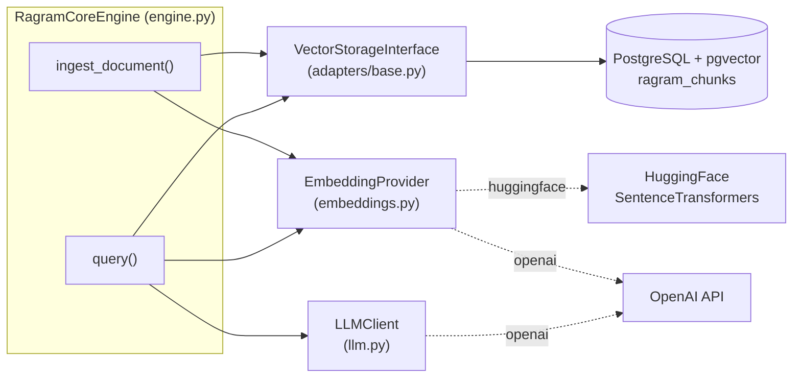
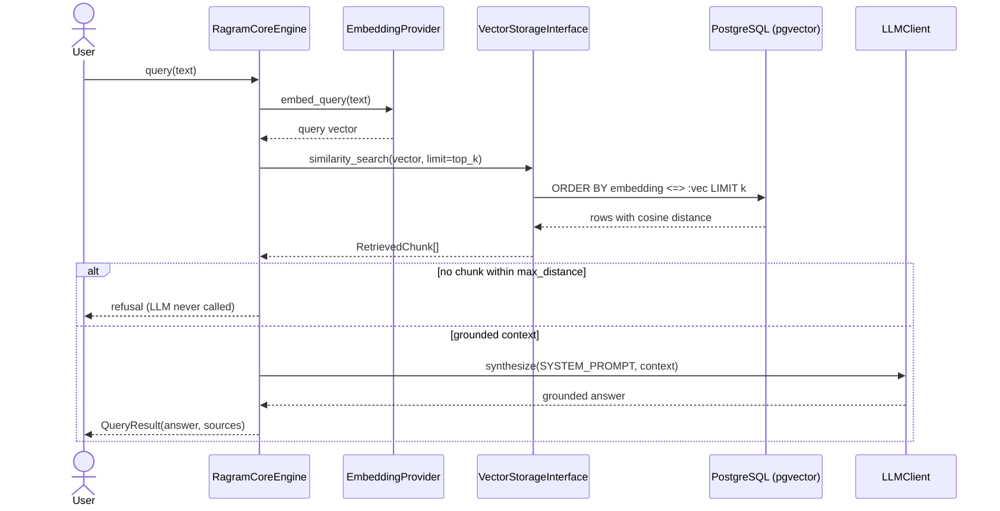

# RAGRAM_Core

**Vector-only baseline tier of the RAGRAM framework.**

RAGRAM Core is a minimal, production-oriented **Naive RAG** (retrieval-augmented
generation) pipeline that runs directly on an existing **PostgreSQL** database via
the **`pgvector`** extension. It is intentionally domain-agnostic and built around a
strict **Repository / Adapter** pattern, so the storage backend, the embedding model,
and the LLM can each be replaced without touching the orchestration logic.

---

## Table of contents

- [Features](#features)
- [Architecture](#architecture)
- [Project structure](#project-structure)
- [Requirements](#requirements)
- [Installation](#installation)
- [Configuration](#configuration)
- [Usage](#usage)
  - [Verification script](#verification-script)
  - [Programmatic usage](#programmatic-usage)
- [Integrating with other systems](#integrating-with-other-systems)
  - [Using an existing production PostgreSQL database](#using-an-existing-production-postgresql-database)
  - [Embedding in a FastAPI service](#embedding-in-a-fastapi-service)
  - [Swapping the storage backend](#swapping-the-storage-backend)
  - [LangChain / LlamaIndex interop](#langchain--llamaindex-interop)
  - [Batch / ETL ingestion](#batch--etl-ingestion)
- [Exposing RAGRAM as a tool](#exposing-ragram-as-a-tool)
  - [As an MCP tool](#as-an-mcp-tool)
  - [As an OpenAI function/tool](#as-an-openai-functiontool)
  - [As a LangChain tool](#as-a-langchain-tool)
  - [As a CLI](#as-a-cli)
- [Anti-hallucination design](#anti-hallucination-design)
- [API reference](#api-reference)
- [Troubleshooting](#troubleshooting)
- [Roadmap](#roadmap)
- [License](#license)

---

## Features

- **Naive RAG over pgvector** — cosine-distance k-NN search with an HNSW index.
- **Adapter pattern** — `VectorStorageInterface` decouples the engine from Postgres.
- **Pluggable embeddings** — OpenAI Embeddings or local HuggingFace SentenceTransformers.
- **Recursive character chunking** — paragraph/sentence-aware splitting with overlap.
- **Two-layer anti-hallucination** — an engine-level context guard *and* a strict
  grounding system prompt.
- **Environment-driven config** — no hardcoded credentials or model names.
- **Idempotent ingestion** — deterministic chunk ids upsert on re-ingest.

---

## Architecture

### Component view



### Query data flow



### Detailed ingest / query flow

```
                              RagramCoreEngine
   ┌────────────────────────────────────────────────────────────────────┐
   │                                                                    │
   │  ingest_document(document)                query(user_query)        │
   │        │                                       │                   │
   │        ▼                                       ▼                   │
   │  recursive_character_split()          EmbeddingProvider            │
   │        │                              .embed_query()               │
   │        ▼                                       │                   │
   │  EmbeddingProvider.embed_documents()           ▼                   │
   │        │                            VectorStorageInterface         │
   │        ▼                            .similarity_search()           │
   │  VectorStorageInterface                        │                   │
   │  .insert_chunk()                               ▼                   │
   │        │                            relevance filter               │
   │        │                            (max_distance)                 │
   │        │                                       │                   │
   │        │                     no context ───────┴──────► refusal    │
   │        │                                       │         answer     │
   │        │                                       ▼                   │
   │        │                     SYSTEM_PROMPT + context               │
   │        │                                       │                   │
   │        │                                       ▼                   │
   │        └─────────────► LLMClient.synthesize() ─┴──────► answer      │
   │                                                                    │
   └───────────────┬──────────────────────┬───────────────────┬─────────┘
                   │                      │                   │
      ┌────────────▼───────┐  ┌───────────▼─────────┐  ┌──────▼─────────┐
      │ VectorStorage      │  │ EmbeddingProvider   │  │ LLMClient      │
      │ Interface (ABC)    │  │ (ABC)               │  │ (ABC)          │
      ├────────────────────┤  ├─────────────────────┤  ├────────────────┤
      │ PostgresVector     │  │ OpenAIEmbedding     │  │ OpenAILLM      │
      │ Adapter (pgvector) │  │ Provider            │  │ Client         │
      │                    │  │ HuggingFaceEmbedding│  │                │
      │                    │  │ Provider            │  │                │
      └─────────┬──────────┘  └─────────────────────┘  └────────────────┘
                │
                ▼
      ┌───────────────────────────────────────────┐
      │ PostgreSQL                                 │
      │  table: ragram_chunks                      │
      │   ├─ chunk_id    TEXT  PRIMARY KEY         │
      │   ├─ text        TEXT                      │
      │   ├─ embedding   VECTOR(dim)  ← HNSW index │
      │   ├─ meta        JSONB                     │
      │   └─ created_at  TIMESTAMPTZ               │
      └───────────────────────────────────────────┘
```

**Query flow:** encode the question → cosine k-NN over `ragram_chunks` → drop chunks
farther than `max_distance` → if nothing remains, return the refusal string without
calling the LLM → otherwise synthesize a grounded answer.

**The pgvector primitive:** nearest-neighbour ordering compiles to the `<=>` cosine
distance operator and is accelerated by an HNSW index using `vector_cosine_ops`:

```sql
CREATE INDEX ix_ragram_chunks_embedding_hnsw
  ON ragram_chunks USING hnsw (embedding vector_cosine_ops);

SELECT chunk_id, text, meta, embedding <=> :query AS distance
FROM ragram_chunks
ORDER BY embedding <=> :query
LIMIT :limit;
```

---

## Project structure

```
RAGRAM_Core/
├── adapters/
│   ├── __init__.py
│   ├── base.py               # VectorStorageInterface (ABC) + RetrievedChunk
│   └── postgres_adapter.py   # PostgresVectorAdapter (pgvector implementation)
├── chunking.py               # recursive_character_split()
├── config.py                 # Settings.from_env()
├── embeddings.py             # EmbeddingProvider (ABC) + OpenAI / HuggingFace
├── engine.py                 # RagramCoreEngine, QueryResult
├── llm.py                    # LLMClient (ABC) + OpenAILLMClient
├── prompts.py                # SYSTEM_PROMPT, NO_CONTEXT_ANSWER, build_context_block()
├── main.py                   # verification script
├── requirements.txt
├── .env.example
└── README.md
```

> **Imports are flat.** Modules are imported as `from engine import RagramCoreEngine`,
> `from adapters.postgres_adapter import PostgresVectorAdapter`, etc.

---

## Requirements

- Python 3.10+
- PostgreSQL with the **`pgvector`** extension installed on the server
- One embedding backend: an OpenAI API key, **or** `sentence-transformers` installed

---

## Installation

```bash
# 1. Create and activate a virtual environment
python -m venv .venv
.venv\Scripts\activate          # Windows PowerShell
# source .venv/bin/activate     # macOS / Linux

# 2. Install dependencies
pip install -r requirements.txt

# 3. Enable pgvector on the target database (once, as a superuser)
psql -h <host> -U <user> -d <db> -c "CREATE EXTENSION IF NOT EXISTS vector;"

# 4. Configure environment
copy .env.example .env          # Windows
# cp .env.example .env          # macOS / Linux
```

The adapter also issues `CREATE EXTENSION IF NOT EXISTS vector` on `connect()`, so a
superuser run is only needed the first time if the extension is not yet present.

---

## Configuration

All configuration is read from environment variables (optionally via a `.env` file).
Nothing is hardcoded.

| Variable | Default | Description |
| --- | --- | --- |
| `RAGRAM_PG_HOST` | `localhost` | PostgreSQL host |
| `RAGRAM_PG_PORT` | `5432` | PostgreSQL port |
| `RAGRAM_PG_USER` | `postgres` | Database user |
| `RAGRAM_PG_PASSWORD` | _(empty)_ | Database password |
| `RAGRAM_PG_DBNAME` | `ragram` | Database name |
| `RAGRAM_EMBEDDING_PROVIDER` | `openai` | `openai` or `huggingface` |
| `RAGRAM_EMBEDDING_MODEL` | `text-embedding-3-small` | Embedding model id |
| `RAGRAM_EMBEDDING_DIM` | `1536` | Must match the model output size |
| `RAGRAM_LLM_MODEL` | `gpt-4o-mini` | Synthesis model |
| `OPENAI_API_KEY` / `RAGRAM_OPENAI_API_KEY` | _(none)_ | OpenAI key for embeddings + synthesis |
| `RAGRAM_CHUNK_SIZE` | `900` | Max characters per chunk |
| `RAGRAM_CHUNK_OVERLAP` | `150` | Overlap between adjacent chunks |
| `RAGRAM_TOP_K` | `5` | Chunks retrieved per query |
| `RAGRAM_MAX_DISTANCE` | `0.5` | Cosine-distance cutoff; `none` disables filtering |

**Dimension cheat-sheet:** `text-embedding-3-small` → `1536`;
`sentence-transformers/all-MiniLM-L6-v2` → `384`. `RAGRAM_EMBEDDING_DIM` **must**
match, otherwise writes and queries raise a clear dimension error.

---

## Usage

### Verification script

`main.py` initializes the schema, ingests a sample document, then runs an in-scope
query (answered from context) and an out-of-scope query (triggers the refusal path).

```bash
python main.py
```

Expected shape of output:

```
Connecting to PostgreSQL at localhost:5432...
Schema ready.
Indexed 3 chunk(s): ['<docid>:0', '<docid>:1', '<docid>:2']

======================================================================
QUERY 1 (in-scope): How does RAGRAM Core perform similarity search?
======================================================================
context_used: True
answer: ... [chunk:<docid>:1] ...
sources:
  - <docid>:1  distance=0.1832  'Retrieval works by encoding the user query ...'

======================================================================
QUERY 2 (out-of-scope): What is the capital of France?
======================================================================
context_used: False
answer: I cannot find sufficient information in the current database context.
```

### Programmatic usage

```python
from config import Settings
from embeddings import create_embedding_provider
from adapters.postgres_adapter import PostgresVectorAdapter
from engine import RagramCoreEngine
from llm import OpenAILLMClient

# 1. Configuration (from env / .env)
settings = Settings.from_env()

# 2. Components (each is swappable — see the integrations section)
embedder = create_embedding_provider(settings)
storage = PostgresVectorAdapter(
    settings.sqlalchemy_url,
    dimension=embedder.dimension,   # pins the VECTOR(dim) column
)
synthesizer = OpenAILLMClient(settings.llm_model, settings.openai_api_key)

# 3. Initialize schema, then wire the engine
storage.connect()
engine = RagramCoreEngine(
    storage, embedder, synthesizer,
    chunk_size=settings.chunk_size,
    chunk_overlap=settings.chunk_overlap,
    top_k=settings.top_k,
    max_distance=settings.max_distance,
)

try:
    # 4. Ingest
    chunk_ids = engine.ingest_document(
        "RAGRAM Core stores vectors in PostgreSQL using pgvector.",
        metadata={"source": "handbook.pdf", "page": 1},
    )

    # 5. Query
    result = engine.query("Where does RAGRAM Core store vectors?")
    print(result.answer)              # grounded answer with [chunk:...] citations
    print(result.context_used)        # False when the refusal path was taken
    for source in result.sources:     # RetrievedChunk objects
        print(source.chunk_id, source.distance, source.metadata)
finally:
    storage.disconnect()
```

---

## Integrating with other systems

### Using an existing production PostgreSQL database

RAGRAM Core is designed to attach to a database you already run:

1. **Reuse the connection** — point `RAGRAM_PG_*` at your existing instance and
   database. The framework creates one dedicated table (`ragram_chunks`, configurable
   via `PostgresVectorAdapter(..., table_name="...")`) and never touches your tables.
2. **Install the extension once** — `CREATE EXTENSION IF NOT EXISTS vector;` requires
   `CREATE` privilege on the database (superuser, or a DBA-run migration).
3. **Isolate in a schema** (optional) — set `search_path` or qualify the table name
   (e.g. `table_name="rag.ragram_chunks"`) to keep RAG objects separate.
4. **Scale reads** — the adapter uses SQLAlchemy pooling (`pool_pre_ping=True`), so it
   is safe behind connection poolers such as PgBouncer.

```python
from adapters.postgres_adapter import PostgresVectorAdapter

storage = PostgresVectorAdapter(
    settings.sqlalchemy_url,
    dimension=embedder.dimension,
    table_name="rag.ragram_chunks",   # dedicated schema for isolation
)
```

### Embedding in a FastAPI service

Build the engine once at startup (the DB pool is reused), then serve queries.

```python
from contextlib import asynccontextmanager
from fastapi import FastAPI
from pydantic import BaseModel

from config import Settings
from embeddings import create_embedding_provider
from adapters.postgres_adapter import PostgresVectorAdapter
from engine import RagramCoreEngine
from llm import OpenAILLMClient

state: dict = {}

@asynccontextmanager
async def lifespan(app: FastAPI):
    settings = Settings.from_env()
    embedder = create_embedding_provider(settings)
    storage = PostgresVectorAdapter(settings.sqlalchemy_url, dimension=embedder.dimension)
    storage.connect()
    state["engine"] = RagramCoreEngine(
        storage, embedder, OpenAILLMClient(settings.llm_model, settings.openai_api_key),
    )
    yield
    storage.disconnect()

app = FastAPI(lifespan=lifespan)

class QueryIn(BaseModel):
    question: str

class SourceOut(BaseModel):
    chunk_id: str
    distance: float
    text: str

class QueryOut(BaseModel):
    answer: str
    context_used: bool
    sources: list[SourceOut]

@app.post("/query", response_model=QueryOut)
def query(body: QueryIn) -> QueryOut:
    result = state["engine"].query(body.question)
    return QueryOut(
        answer=result.answer,
        context_used=result.context_used,
        sources=[SourceOut(chunk_id=s.chunk_id, distance=s.distance, text=s.text)
                 for s in result.sources],
    )
```

> The engine is synchronous. Under an async framework, run `engine.query(...)` in a
> threadpool (e.g. `anyio.to_thread.run_sync(...)`) so the event loop is not blocked.

### Swapping the storage backend

The engine depends only on `VectorStorageInterface`. To target another store, implement
the four methods and pass your adapter to the engine — no engine changes required.

```python
from typing import Any
from adapters.base import RetrievedChunk, VectorStorageInterface

class PineconeAdapter(VectorStorageInterface):
    def connect(self) -> None: ...
    def disconnect(self) -> None: ...
    def insert_chunk(self, chunk_id: str, text: str,
                     embedding: list[float], metadata: dict[str, Any]) -> None: ...
    def similarity_search(self, query_embedding: list[float],
                          limit: int = 5) -> list[RetrievedChunk]: ...

engine = RagramCoreEngine(PineconeAdapter(...), embedder, synthesizer)
```

The same applies to `EmbeddingProvider` (swap in Cohere, Voyage, Ollama, ...) and
`LLMClient` (swap in Anthropic, Bedrock, a local model, ...).

### LangChain / LlamaIndex interop

Each abstraction is a thin adapter boundary, so bridging to those frameworks is small.

**Use LangChain embeddings inside RAGRAM** — wrap a LangChain `Embeddings` object:

```python
from langchain_openai import OpenAIEmbeddings
from embeddings import EmbeddingProvider

class LangChainEmbeddingProvider(EmbeddingProvider):
    def __init__(self, inner, dimension: int) -> None:
        self._inner = inner
        self.dimension = dimension

    def embed_documents(self, texts: list[str]) -> list[list[float]]:
        return self._inner.embed_documents(texts)

    def embed_query(self, text: str) -> list[float]:
        return self._inner.embed_query(text)

embedder = LangChainEmbeddingProvider(OpenAIEmbeddings(model="text-embedding-3-small"), 1536)
```

**Expose RAGRAM as a LangChain retriever** — use RAGRAM's vector search as the backend:

```python
from langchain_core.retrievers import BaseRetriever
from langchain_core.documents import Document

class RagramRetriever(BaseRetriever):
    engine: object  # RagramCoreEngine

    def _get_relevant_documents(self, query: str, *, run_manager=None) -> list[Document]:
        vector = self.engine._embedder.embed_query(query)          # or expose a public helper
        hits = self.engine._storage.similarity_search(vector, limit=self.engine._top_k)
        return [Document(page_content=h.text, metadata={**h.metadata, "chunk_id": h.chunk_id})
                for h in hits]
```

> The examples above are illustrative bridges built on the public interfaces; they are
> not shipped as first-party plugins. Prefer constructing adapters explicitly rather
> than reaching into private attributes in production (a public `retrieve()` helper is
> on the [roadmap](#roadmap)).

### Batch / ETL ingestion

`ingest_document()` is synchronous and idempotent, which makes it easy to drive from
pipelines. Re-ingesting the same content with the same document id overwrites chunks
instead of duplicating them.

```python
engine = RagramCoreEngine(storage, embedder, synthesizer)

for row in source_rows:                       # e.g. rows from your existing DB
    engine.ingest_document(
        row["body"],
        metadata={"source": row["url"], "entity_id": row["id"]},
    )
```

For very large corpora, ingest in a background worker and batch embeddings through the
provider; the OpenAI provider already sends whole batches in a single API call.

---

## Exposing RAGRAM as a tool

`RagramCoreEngine.query()` is a plain synchronous call, so it drops into any agent or
tool-calling framework. The recipes below build on the public API; only the MCP recipe
adds a dependency (`pip install "mcp[cli]"`).

### As an MCP tool

Serve RAGRAM over the Model Context Protocol (stdio transport) so MCP clients such as
Claude Desktop or opencode can call it as a tool.

```python
# tools/mcp_server.py
from mcp.server.fastmcp import FastMCP

from config import Settings
from embeddings import create_embedding_provider
from adapters.postgres_adapter import PostgresVectorAdapter
from engine import RagramCoreEngine
from llm import OpenAILLMClient

settings = Settings.from_env()
embedder = create_embedding_provider(settings)
storage = PostgresVectorAdapter(settings.sqlalchemy_url, dimension=embedder.dimension)
storage.connect()
engine = RagramCoreEngine(
    storage, embedder,
    OpenAILLMClient(settings.llm_model, settings.openai_api_key),
    top_k=settings.top_k, max_distance=settings.max_distance,
)

mcp = FastMCP("ragram-core")

@mcp.tool()
def ragram_query(question: str) -> dict:
    """Answer a question strictly from the indexed knowledge base.

    Returns the grounded answer, whether context was used, and the source chunks.
    """
    result = engine.query(question)
    return {
        "answer": result.answer,
        "context_used": result.context_used,
        "sources": [{"chunk_id": s.chunk_id, "distance": s.distance} for s in result.sources],
    }

if __name__ == "__main__":
    mcp.run()  # stdio transport by default
```

Register it with an MCP client, e.g.:

```json
{
  "mcpServers": {
    "ragram-core": { "command": "python", "args": ["tools/mcp_server.py"] }
  }
}
```

### As an OpenAI function/tool

Advertise RAGRAM as a callable tool to a chat-completions agent.

```python
tools = [{
    "type": "function",
    "function": {
        "name": "ragram_query",
        "description": "Answer a question strictly from the RAGRAM knowledge base; "
                       "refuses when the answer is not in the indexed context.",
        "parameters": {
            "type": "object",
            "properties": {"question": {"type": "string"}},
            "required": ["question"],
        },
    },
}]

# Dispatch the model's tool call back into the engine.
def ragram_query(question: str) -> str:
    return engine.query(question).answer
```

### As a LangChain tool

```python
from langchain_core.tools import tool

@tool
def ragram_query(question: str) -> str:
    """Answer strictly from the RAGRAM knowledge base; refuses if unsupported."""
    return engine.query(question).answer
```

### As a CLI

Wrap the engine in a minimal entrypoint for scripts and CI checks.

```python
# cli.py
import argparse, json

from config import Settings
from embeddings import create_embedding_provider
from adapters.postgres_adapter import PostgresVectorAdapter
from engine import RagramCoreEngine
from llm import OpenAILLMClient

def main() -> None:
    parser = argparse.ArgumentParser(prog="ragram")
    sub = parser.add_subparsers(dest="cmd", required=True)
    q = sub.add_parser("query"); q.add_argument("question")

    args = parser.parse_args()
    settings = Settings.from_env()
    embedder = create_embedding_provider(settings)
    storage = PostgresVectorAdapter(settings.sqlalchemy_url, dimension=embedder.dimension)
    storage.connect()
    try:
        engine = RagramCoreEngine(
            storage, embedder,
            OpenAILLMClient(settings.llm_model, settings.openai_api_key),
        )
        if args.cmd == "query":
            result = engine.query(args.question)
            print(json.dumps({
                "answer": result.answer,
                "context_used": result.context_used,
                "sources": [s.chunk_id for s in result.sources],
            }, indent=2))
    finally:
        storage.disconnect()

if __name__ == "__main__":
    main()
```

```bash
python cli.py query "Where does RAGRAM Core store vectors?"
```

---

## Anti-hallucination design

Two independent layers prevent fabrication:

1. **Engine guard (deterministic).** After retrieval, chunks farther than
   `max_distance` are discarded. If none remain, the engine returns
   `NO_CONTEXT_ANSWER` and **never calls the LLM** (`context_used=False`).
2. **Strict system prompt.** When context *is* present, `SYSTEM_PROMPT` forbids using
   outside knowledge, disallows speculation, requires `[chunk:<id>]` citations, and
   mandates the exact refusal sentence when the context is insufficient:

   > `I cannot find sufficient information in the current database context.`

Both the guard and the prompt use the same constant (`prompts.NO_CONTEXT_ANSWER`), so
the refusal message stays consistent regardless of which layer triggers it.

---

## API reference

| Symbol | Location | Purpose |
| --- | --- | --- |
| `Settings.from_env()` | `config` | Load + validate env configuration |
| `VectorStorageInterface` | `adapters.base` | Storage abstraction (`connect`, `disconnect`, `insert_chunk`, `similarity_search`) |
| `RetrievedChunk` | `adapters.base` | `chunk_id`, `text`, `metadata`, `distance` |
| `PostgresVectorAdapter` | `adapters.postgres_adapter` | pgvector-backed storage |
| `EmbeddingProvider` | `embeddings` | Embedding abstraction |
| `create_embedding_provider(settings)` | `embeddings` | Provider factory |
| `recursive_character_split(text, size, overlap)` | `chunking` | Chunks a document |
| `LLMClient` | `llm` | Synthesis abstraction |
| `OpenAILLMClient(model, api_key)` | `llm` | OpenAI synthesis |
| `RagramCoreEngine(...)` | `engine` | Pipeline coordinator |
| `.ingest_document(document, metadata=None)` | `engine` | Returns stored chunk ids |
| `.query(user_query)` | `engine` | Returns `QueryResult` |
| `QueryResult` | `engine` | `answer`, `sources`, `context_used` |
| `SYSTEM_PROMPT`, `NO_CONTEXT_ANSWER` | `prompts` | Grounding prompt + refusal text |

---

## Troubleshooting

| Symptom | Cause / fix |
| --- | --- |
| `type "vector" does not exist` | pgvector not installed on the server. Run `CREATE EXTENSION vector;` as a superuser. |
| `Embedding has dimension N, but the storage schema expects M` | Fix `RAGRAM_EMBEDDING_DIM` to match your model. |
| `ModuleNotFoundError: psycopg` | Install the driver: `pip install "psycopg[binary]>=3.1"`. |
| `ModuleNotFoundError: sentence_transformers` | Only needed for `RAGRAM_EMBEDDING_PROVIDER=huggingface`; install `sentence-transformers`. |
| Every query returns the refusal | `RAGRAM_MAX_DISTANCE` too strict, or the document was never ingested. Try `none` to inspect raw distances. |
| Connection refused / auth error | Verify `RAGRAM_PG_*` values and that the DB is reachable. |

---

## Roadmap

- Public `retrieve()` helper and a first-party LangChain/LlamaIndex retriever.
- Hybrid search (BM25 + vector) and metadata-filtered retrieval.
- Async adapters and batch-upsert ingestion.
- Additional adapters (pgvector+pgvectorscale, Qdrant, Weaviate, Pinecone).
- Evaluation harness (recall@k, groundedness).

---

## License

No license file is present yet. Add a `LICENSE` before distributing or publishing.
