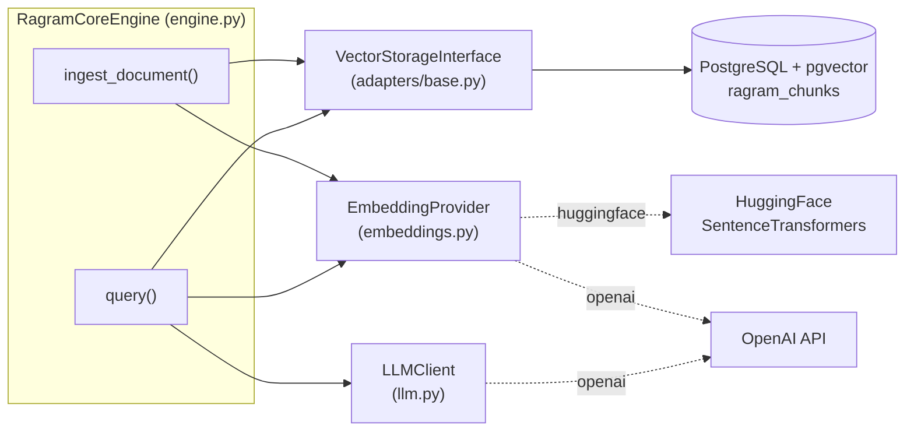
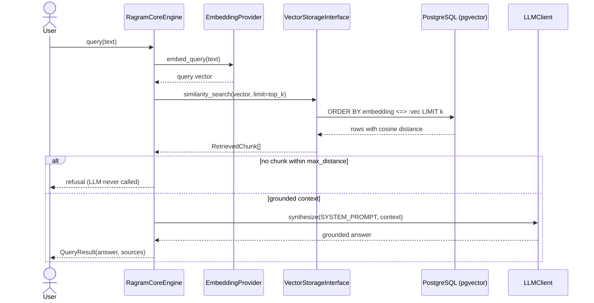

# RAGRAM Core

**A small, readable starting point for building RAG on your own PostgreSQL database.**

RAGRAM Core is a minimal, well-labelled **Naive RAG** (retrieval-augmented generation)
starter. You give it your text; it stores that text as vectors inside an ordinary
PostgreSQL database using the `pgvector` extension; later you ask questions and get
answers built strictly from *your* text — with the exact sources shown, and an honest
"I cannot find sufficient information..." when the answer isn't there.

It's small enough to read in an afternoon, yet organised enough to grow: the database,
the embedding model, and the language model can each be swapped out without rewriting
the core logic.

> **New to RAG?** You're in the right place. Start with the guides below, then come
> back here for the details. You don't need any machine-learning background.

| Guide | What it's for |
| --- | --- |
| [docs/GETTING_STARTED.md](docs/GETTING_STARTED.md) | Install everything and run your first query, step by step. |
| [docs/CONCEPTS.md](docs/CONCEPTS.md) | Plain-English explanations of RAG, embeddings, vectors, and every other term. |

Want to see more before diving in? These tools turn the repository itself into
something you can explore:

- **[gitingest](https://gitingest.com/ramprakash-munugapati/ragram_core)** — the whole
  codebase as one readable, digestible text file.
- **[gitdiagram](https://gitdiagram.com/ramprakash-munugapati/ragram_core)** — an
  auto-generated diagram of how the code fits together.

---

## Table of contents

- [What is RAG?](#what-is-rag)
- [How RAGRAM Core works](#how-ragram-core-works)
- [Features](#features)
- [Architecture](#architecture)
- [Project structure](#project-structure)
- [Requirements](#requirements)
- [Installation](#installation)
- [Configuration](#configuration)
- [Usage](#usage)
  - [Verification script](#verification-script)
  - [Programmatic usage](#programmatic-usage)
  - [Web UI (Streamlit)](#web-ui-streamlit)
- [Integrating with other systems](#integrating-with-other-systems)
  - [Using an existing production PostgreSQL database](#using-an-existing-production-postgresql-database)
  - [Embedding in a FastAPI service](#embedding-in-a-fastapi-service)
  - [Swapping the storage backend](#swapping-the-storage-backend)
  - [LangChain / LlamaIndex interop](#langchain--llamaindex-interop)
  - [Batch / ETL ingestion](#batch--etl-ingestion)
- [Exposing RAGRAM as a tool](#exposing-ragram-as-a-tool)
  - [As an MCP tool](#as-an-mcp-tool)
  - [As an OpenAI function/tool](#as-an-openai-functiontool)
  - [As a LangChain tool](#as-a-langchain-tool)
  - [As a CLI](#as-a-cli)
- [Anti-hallucination design](#anti-hallucination-design)
- [API reference](#api-reference)
- [Troubleshooting](#troubleshooting)
- [Roadmap](#roadmap)
- [License](#license)

---

## What is RAG?

RAG stands for **Retrieval-Augmented Generation**. In one line: *look up the relevant
text first, hand it to the AI, and ask the AI to answer using only that text.*

That's it. The AI (the "generation" part) isn't answering from memory — it's answering
from your documents, which we just found and handed to it (the "retrieval" and
"augmented" parts). This small change is what makes the answers trustworthy and
traceable to real sources.

Why bother, instead of just asking an AI directly?

- **It knows your data.** The AI can't know your notes, handbook, or database — but RAG
  hands it the relevant parts.
- **It makes things up less.** With only real text to work from, the model is far less
  likely to invent an answer.
- **It stays current.** Your text lives in your database and is looked up fresh on every
  question, so it can be as new as you like.

Want the full story, with analogies? See
[docs/CONCEPTS.md](docs/CONCEPTS.md). The short version is below.

---

## How RAGRAM Core works

Two phases, one small file each in your head:

**1. Ingestion (once per document)**

```
your text  ─►  cut into small chunks  ─►  turn each chunk into a vector  ─►  store in PostgreSQL
```

**2. Query (every time you ask something)**

```
your question  ─►  turn it into a vector  ─►  find the closest chunks in PostgreSQL
      │
      ├─ nothing close enough?  ─►  say "I cannot find sufficient information..." (AI is never called)
      │
      └─ found relevant chunks  ─►  ask the AI to answer using ONLY those chunks
                                        └─► answer + the exact sources used
```

The "vector" is just a list of numbers that captures the *meaning* of a piece of text.
Similar meaning → similar numbers, which is how "find the closest chunks" becomes a
quick maths lookup instead of keyword matching. (Prefer keyword search? That's a
different technique — this project is the vector one on purpose.)

That last branch — refusing when nothing relevant is found — is the most important
safety feature here, and it's explained in
[Anti-hallucination design](#anti-hallucination-design).

---

## Features

Written plainly, with the technical name in parentheses for when you're ready:

- **Similarity search with Postgres** — finds the most relevant chunks by cosine
  distance, sped up by an HNSW index (Naive RAG over pgvector).
- **Swappable database** — the engine talks to an interface, not to Postgres directly
  (the Adapter pattern via `VectorStorageInterface`).
- **Swappable embeddings** — use OpenAI's embeddings, or run a small model on your own
  machine for free (`EmbeddingProvider`).
- **Smart chunking** — splits text at natural boundaries (paragraphs, then sentences)
  with overlap, so ideas aren't cut in half (`recursive_character_split`).
- **Two layers of anti-hallucination** — a hard rule in code *and* a strict instruction
  to the AI, so answers stay grounded.
- **No hardcoded secrets** — everything comes from environment variables / `.env`.
- **Safe to re-run** — ingesting the same document again updates it instead of
  duplicating it (idempotent upsert).
- **Streaming answers** — the reply appears word by word (`stream_query`).
- **A friendly web UI** — a Streamlit app for asking questions, viewing sources, and
  adding documents (`ui/app.py`).

---

## Architecture

If you only read one diagram, read this one. It shows how a question is answered.

### Component view



The engine sits in the middle and depends on three **interfaces** (the dashed boxes).
Any of them can be replaced by another implementation without touching the engine. The
only concrete pieces shipped today are a Postgres adapter, OpenAI/HuggingFace
embeddings, and an OpenAI synthesizer — but the shape is deliberately pluggable.

### Query data flow



### Detailed ingest / query flow

```
                              RagramCoreEngine
   ┌────────────────────────────────────────────────────────────────────┐
   │                                                                    │
   │  ingest_document(document)                query(user_query)        │
   │        │                                       │                   │
   │        ▼                                       ▼                   │
   │  recursive_character_split()          EmbeddingProvider            │
   │        │                              .embed_query()               │
   │        ▼                                       │                   │
   │  EmbeddingProvider.embed_documents()           ▼                   │
   │        │                            VectorStorageInterface         │
   │        ▼                            .similarity_search()           │
   │  VectorStorageInterface                        │                   │
   │  .insert_chunk()                               ▼                   │
   │        │                            relevance filter               │
   │        │                            (max_distance)                 │
   │        │                                       │                   │
   │        │                     no context ───────┴──────► refusal    │
   │        │                                       │         answer     │
   │        │                                       ▼                   │
   │        │                     SYSTEM_PROMPT + context               │
   │        │                                       │                   │
   │        │                                       ▼                   │
   │        └─────────────► LLMClient.synthesize() ─┴──────► answer      │
   │                                                                    │
   └───────────────┬──────────────────────┬───────────────────┬─────────┘
                   │                      │                   │
      ┌────────────▼───────┐  ┌───────────▼─────────┐  ┌──────▼─────────┐
      │ VectorStorage      │  │ EmbeddingProvider   │  │ LLMClient      │
      │ Interface (ABC)    │  │ (ABC)               │  │ (ABC)          │
      ├────────────────────┤  ├─────────────────────┤  ├────────────────┤
      │ PostgresVector     │  │ OpenAIEmbedding     │  │ OpenAILLM      │
      │ Adapter (pgvector) │  │ Provider            │  │ Client         │
      │                    │  │ HuggingFaceEmbedding│  │                │
      │                    │  │ Provider            │  │                │
      └─────────┬──────────┘  └─────────────────────┘  └────────────────┘
                │
                ▼
      ┌───────────────────────────────────────────┐
      │ PostgreSQL                                 │
      │  table: ragram_chunks                      │
      │   ├─ chunk_id    TEXT  PRIMARY KEY         │
      │   ├─ text        TEXT                      │
      │   ├─ embedding   VECTOR(dim)  ← HNSW index │
      │   ├─ meta        JSONB                     │
      │   └─ created_at  TIMESTAMPTZ               │
      └───────────────────────────────────────────┘
```

**In words:** a question is turned into a vector, PostgreSQL finds the nearest chunk
vectors (cosine distance), chunks that are too far away are dropped, and — if anything
relevant remains — those chunks are handed to the AI with instructions to answer only
from them, and cite their ids. If nothing relevant remains, the AI is never called.

**The pgvector query.** The "nearest chunks" search compiles to this SQL. `<=>` is
pgvector's cosine-distance operator, and the HNSW index (`vector_cosine_ops`) makes it
fast:

```sql
CREATE INDEX ix_ragram_chunks_embedding_hnsw
  ON ragram_chunks USING hnsw (embedding vector_cosine_ops);

SELECT chunk_id, text, meta, embedding <=> :query AS distance
FROM ragram_chunks
ORDER BY embedding <=> :query
LIMIT :limit;
```

---

## Project structure

```
RAGRAM_Core/
├── adapters/
│   ├── __init__.py
│   ├── base.py               # VectorStorageInterface (ABC) + RetrievedChunk
│   └── postgres_adapter.py   # PostgresVectorAdapter (the pgvector implementation)
├── chunking.py               # recursive_character_split()
├── config.py                 # Settings.from_env()
├── embeddings.py             # EmbeddingProvider (ABC) + OpenAI / HuggingFace
├── engine.py                 # RagramCoreEngine, QueryResult, QueryStream
├── llm.py                    # LLMClient (ABC) + OpenAILLMClient
├── prompts.py                # SYSTEM_PROMPT, NO_CONTEXT_ANSWER, build_context_block()
├── main.py                   # verification script
├── ui/
│   └── app.py                # Streamlit web UI
├── docs/
│   ├── GETTING_STARTED.md    # step-by-step first run
│   └── CONCEPTS.md           # plain-English concepts + glossary
├── requirements.txt
├── .env.example
└── README.md
```

**A good reading order for the code:** `engine.py` (the coordinator that ties
everything together) → `adapters/postgres_adapter.py` (all the database work) →
`prompts.py` (the rules that keep answers honest).

> **Imports are flat.** Modules import each other like `from engine import
> RagramCoreEngine` and `from adapters.postgres_adapter import PostgresVectorAdapter`.

---

## Requirements

- **Python 3.10 or newer.**
- **PostgreSQL** with the **`pgvector`** extension available on the server.
- For embeddings: an **OpenAI API key**, *or* `sentence-transformers` installed for the
  free local option.
- For the answer-writing step (by default): an **OpenAI API key**.

New to all this? The [Getting Started guide](docs/GETTING_STARTED.md) walks through
installing each of these — including the easiest way to get PostgreSQL + pgvector (a
single Docker command).

---

## Installation

```bash
# 1. Create and activate a virtual environment
python -m venv .venv
.venv\Scripts\activate          # Windows PowerShell
# source .venv/bin/activate     # macOS / Linux

# 2. Install dependencies
pip install -r requirements.txt

# 3. Enable pgvector on the target database (once, as a superuser)
psql -h <host> -U <user> -d <db> -c "CREATE EXTENSION IF NOT EXISTS vector;"

# 4. Configure environment
copy .env.example .env          # Windows
# cp .env.example .env          # macOS / Linux
```

RAGRAM Core also tries to create the pgvector extension automatically when it connects,
so the superuser step is only needed the first time if the extension isn't present yet.

---

## Configuration

Everything is configured through environment variables (usually via your `.env` file).
Nothing is hardcoded — no secrets or model names live in the code.

| Variable | Default | What it does |
| --- | --- | --- |
| `RAGRAM_PG_HOST` | `localhost` | Database host |
| `RAGRAM_PG_PORT` | `5432` | Database port |
| `RAGRAM_PG_USER` | `postgres` | Database user |
| `RAGRAM_PG_PASSWORD` | _(empty)_ | Database password |
| `RAGRAM_PG_DBNAME` | `ragram` | Database name |
| `RAGRAM_EMBEDDING_PROVIDER` | `openai` | `openai` or `huggingface` |
| `RAGRAM_EMBEDDING_MODEL` | `text-embedding-3-small` | Which embedding model to use |
| `RAGRAM_EMBEDDING_DIM` | `1536` | Must match the model's output size |
| `RAGRAM_LLM_MODEL` | `gpt-4o-mini` | Which model writes the final answer |
| `OPENAI_API_KEY` / `RAGRAM_OPENAI_API_KEY` | _(none)_ | OpenAI key for embeddings + answers |
| `RAGRAM_CHUNK_SIZE` | `900` | Max characters per chunk |
| `RAGRAM_CHUNK_OVERLAP` | `150` | Characters shared between neighbouring chunks |
| `RAGRAM_TOP_K` | `5` | How many chunks to retrieve per question |
| `RAGRAM_MAX_DISTANCE` | `0.5` | Relevance cutoff; `none` turns the filter off |

**Which dimension do I need?** `text-embedding-3-small` → `1536`;
`sentence-transformers/all-MiniLM-L6-v2` → `384`. `RAGRAM_EMBEDDING_DIM` **must** match
your embedding model, or you'll get a clear dimension error on the first write or query.
(Why? See [CONCEPTS.md](docs/CONCEPTS.md) section 5.)

---

## Usage

### Verification script

The quickest way to see the whole pipeline work. It creates the schema, indexes a short
sample document, then runs two queries — one it can answer, and one it can't.

```bash
python main.py
```

Expected output:

```
Connecting to PostgreSQL at localhost:5432...
Schema ready.
Indexed 3 chunk(s): ['<docid>:0', '<docid>:1', '<docid>:2']

======================================================================
QUERY 1 (in-scope): How does RAGRAM Core perform similarity search?
======================================================================
context_used: True
answer: ... [chunk:<docid>:1] ...
sources:
  - <docid>:1  distance=0.1832  'Retrieval works by encoding the user query ...'

======================================================================
QUERY 2 (out-of-scope): What is the capital of France?
======================================================================
context_used: False
answer: I cannot find sufficient information in the current database context.
```

The first query is answered from the text and lists its source. The second isn't in the
text, so RAGRAM Core refuses instead of guessing — that's the behavior we *want*.

### Programmatic usage

```python
from config import Settings
from embeddings import create_embedding_provider
from adapters.postgres_adapter import PostgresVectorAdapter
from engine import RagramCoreEngine
from llm import OpenAILLMClient

# 1. Read configuration from the environment / .env file.
settings = Settings.from_env()

# 2. Build the three pluggable pieces (swap any of them -- see below).
embedder = create_embedding_provider(settings)
storage = PostgresVectorAdapter(
    settings.sqlalchemy_url,
    dimension=embedder.dimension,   # this pins the VECTOR(dim) column size
)
synthesizer = OpenAILLMClient(settings.llm_model, settings.openai_api_key)

# 3. Create the table/index, then wire the pieces together in the engine.
storage.connect()
engine = RagramCoreEngine(
    storage, embedder, synthesizer,
    chunk_size=settings.chunk_size,
    chunk_overlap=settings.chunk_overlap,
    top_k=settings.top_k,
    max_distance=settings.max_distance,
)

try:
    # 4. Add a document.
    chunk_ids = engine.ingest_document(
        "RAGRAM Core stores vectors in PostgreSQL using pgvector.",
        metadata={"source": "handbook.pdf", "page": 1},
    )

    # 5. Ask a question.
    result = engine.query("Where does RAGRAM Core store vectors?")
    print(result.answer)              # the grounded answer, with [chunk:...] citations
    print(result.context_used)        # False means it took the refusal path
    for source in result.sources:     # the chunks that were used
        print(source.chunk_id, source.distance, source.metadata)
finally:
    storage.disconnect()              # always clean up the connection
```

### Web UI (Streamlit)

`ui/app.py` is a small Streamlit front-end over the engine — no extra frontend build
step.

- **Query tab** — ask questions; answers **stream** in word by word, and each response
  lists the chunks it used, with their distances and metadata.
- **Ingest tab** — add your own text by pasting or uploading a `.txt`, `.md`, `.csv`, or
  `.json` file.
- **Sidebar** — connection status, plus live `top_k` and `max_distance` controls so you
  can feel how retrieval changes.

```bash
pip install streamlit          # already in requirements.txt
streamlit run ui/app.py
```

Open `http://localhost:8501`. It reads the same `.env` as `main.py`, so it needs valid
PostgreSQL and OpenAI credentials; if something's missing it shows a message instead of
crashing.

> Under the hood it uses `RagramCoreEngine.retrieve()` and `stream_query()`: retrieval
> happens first (so sources are known immediately), then the answer streams in — and the
> refusal path still never calls the LLM.

---

## Integrating with other systems

RAGRAM Core is built to slot into things you already run. Below are recipes; each one
uses the public API.

### Using an existing production PostgreSQL database

You don't need a separate database just for RAG. Point RAGRAM Core at your existing one:

1. **Reuse your connection** — set `RAGRAM_PG_*` to your instance. It creates exactly one
   table (`ragram_chunks`, renameable via `table_name=`) and never touches your others.
2. **Enable the extension once** — `CREATE EXTENSION IF NOT EXISTS vector;` needs
   `CREATE` privilege on the database (a superuser, or a one-time DBA migration).
3. **Keep it tidy (optional)** — put RAG objects in their own schema, e.g.
   `table_name="rag.ragram_chunks"`.
4. **It pools connections** — the adapter uses SQLAlchemy pooling with
   `pool_pre_ping=True`, so it plays nicely behind a pooler like PgBouncer.

```python
from adapters.postgres_adapter import PostgresVectorAdapter

storage = PostgresVectorAdapter(
    settings.sqlalchemy_url,
    dimension=embedder.dimension,
    table_name="rag.ragram_chunks",   # keep RAG objects in their own schema
)
```

### Embedding in a FastAPI service

Build the engine once when the app starts (the DB pool is reused), then serve queries.

```python
from contextlib import asynccontextmanager
from fastapi import FastAPI
from pydantic import BaseModel

from config import Settings
from embeddings import create_embedding_provider
from adapters.postgres_adapter import PostgresVectorAdapter
from engine import RagramCoreEngine
from llm import OpenAILLMClient

state: dict = {}

@asynccontextmanager
async def lifespan(app: FastAPI):
    settings = Settings.from_env()
    embedder = create_embedding_provider(settings)
    storage = PostgresVectorAdapter(settings.sqlalchemy_url, dimension=embedder.dimension)
    storage.connect()
    state["engine"] = RagramCoreEngine(
        storage, embedder, OpenAILLMClient(settings.llm_model, settings.openai_api_key),
    )
    yield
    storage.disconnect()

app = FastAPI(lifespan=lifespan)

class QueryIn(BaseModel):
    question: str

class SourceOut(BaseModel):
    chunk_id: str
    distance: float
    text: str

class QueryOut(BaseModel):
    answer: str
    context_used: bool
    sources: list[SourceOut]

@app.post("/query", response_model=QueryOut)
def query(body: QueryIn) -> QueryOut:
    result = state["engine"].query(body.question)
    return QueryOut(
        answer=result.answer,
        context_used=result.context_used,
        sources=[SourceOut(chunk_id=s.chunk_id, distance=s.distance, text=s.text)
                 for s in result.sources],
    )
```

> The engine is synchronous. In an async framework, run `engine.query(...)` in a
> threadpool (e.g. `anyio.to_thread.run_sync(...)`) so you don't block the event loop.

### Swapping the storage backend

The engine only knows about `VectorStorageInterface`. Implement its four methods, pass
your adapter in — and the engine doesn't change at all.

```python
from typing import Any
from adapters.base import RetrievedChunk, VectorStorageInterface

class PineconeAdapter(VectorStorageInterface):
    def connect(self) -> None: ...
    def disconnect(self) -> None: ...
    def insert_chunk(self, chunk_id: str, text: str,
                     embedding: list[float], metadata: dict[str, Any]) -> None: ...
    def similarity_search(self, query_embedding: list[float],
                          limit: int = 5) -> list[RetrievedChunk]: ...

engine = RagramCoreEngine(PineconeAdapter(...), embedder, synthesizer)
```

The same idea applies to `EmbeddingProvider` (Cohere, Voyage, Ollama, ...) and
`LLMClient` (Anthropic, Bedrock, a local model, ...).

### LangChain / LlamaIndex interop

Each interface is a thin boundary, so bridging is small. Two common directions:

**Use LangChain embeddings inside RAGRAM** — wrap a LangChain `Embeddings` object:

```python
from langchain_openai import OpenAIEmbeddings
from embeddings import EmbeddingProvider

class LangChainEmbeddingProvider(EmbeddingProvider):
    def __init__(self, inner, dimension: int) -> None:
        self._inner = inner
        self.dimension = dimension

    def embed_documents(self, texts: list[str]) -> list[list[float]]:
        return self._inner.embed_documents(texts)

    def embed_query(self, text: str) -> list[float]:
        return self._inner.embed_query(text)

embedder = LangChainEmbeddingProvider(OpenAIEmbeddings(model="text-embedding-3-small"), 1536)
```

**Use RAGRAM as a LangChain retriever** — back it with RAGRAM's vector search:

```python
from langchain_core.retrievers import BaseRetriever
from langchain_core.documents import Document

class RagramRetriever(BaseRetriever):
    engine: object  # RagramCoreEngine

    def _get_relevant_documents(self, query: str, *, run_manager=None) -> list[Document]:
        hits = self.engine.retrieve(query)   # public helper: returns the relevant chunks
        return [Document(page_content=h.text, metadata={**h.metadata, "chunk_id": h.chunk_id})
                for h in hits]
```

> These are illustrative bridges built on the public interfaces — not shipped plugins.
> They're a good starting point, not a fully supported framework integration.

### Batch / ETL ingestion

`ingest_document()` is synchronous and safe to re-run, which makes it easy to drive from
a pipeline. Re-ingesting the same content overwrites its chunks instead of duplicating
them.

```python
engine = RagramCoreEngine(storage, embedder, synthesizer)

for row in source_rows:                       # e.g. rows from your existing database
    engine.ingest_document(
        row["body"],
        metadata={"source": row["url"], "entity_id": row["id"]},
    )
```

For very large corpora, run ingestion in a background worker. The OpenAI embedding
provider already sends batches in a single API call.

---

## Exposing RAGRAM as a tool

`RagramCoreEngine.query()` is a plain synchronous call, so it drops into any agent or
tool-calling framework. Only the MCP recipe below adds a dependency
(`pip install "mcp[cli]"`).

### As an MCP tool

Serve RAGRAM over the Model Context Protocol (stdio transport) so MCP clients like
Claude Desktop or opencode can call it as a tool.

```python
# tools/mcp_server.py
from mcp.server.fastmcp import FastMCP

from config import Settings
from embeddings import create_embedding_provider
from adapters.postgres_adapter import PostgresVectorAdapter
from engine import RagramCoreEngine
from llm import OpenAILLMClient

settings = Settings.from_env()
embedder = create_embedding_provider(settings)
storage = PostgresVectorAdapter(settings.sqlalchemy_url, dimension=embedder.dimension)
storage.connect()
engine = RagramCoreEngine(
    storage, embedder,
    OpenAILLMClient(settings.llm_model, settings.openai_api_key),
    top_k=settings.top_k, max_distance=settings.max_distance,
)

mcp = FastMCP("ragram-core")

@mcp.tool()
def ragram_query(question: str) -> dict:
    """Answer a question strictly from the indexed knowledge base.

    Returns the grounded answer, whether context was used, and the source chunks.
    """
    result = engine.query(question)
    return {
        "answer": result.answer,
        "context_used": result.context_used,
        "sources": [{"chunk_id": s.chunk_id, "distance": s.distance} for s in result.sources],
    }

if __name__ == "__main__":
    mcp.run()  # stdio transport by default
```

Register it with an MCP client, e.g.:

```json
{
  "mcpServers": {
    "ragram-core": { "command": "python", "args": ["tools/mcp_server.py"] }
  }
}
```

### As an OpenAI function/tool

Advertise RAGRAM as a callable tool to a chat-completions agent.

```python
tools = [{
    "type": "function",
    "function": {
        "name": "ragram_query",
        "description": "Answer a question strictly from the RAGRAM knowledge base; "
                       "refuses when the answer is not in the indexed context.",
        "parameters": {
            "type": "object",
            "properties": {"question": {"type": "string"}},
            "required": ["question"],
        },
    },
}]

# Dispatch the model's tool call back into the engine.
def ragram_query(question: str) -> str:
    return engine.query(question).answer
```

### As a LangChain tool

```python
from langchain_core.tools import tool

@tool
def ragram_query(question: str) -> str:
    """Answer strictly from the RAGRAM knowledge base; refuses if unsupported."""
    return engine.query(question).answer
```

### As a CLI

```python
# cli.py
import argparse, json

from config import Settings
from embeddings import create_embedding_provider
from adapters.postgres_adapter import PostgresVectorAdapter
from engine import RagramCoreEngine
from llm import OpenAILLMClient

def main() -> None:
    parser = argparse.ArgumentParser(prog="ragram")
    sub = parser.add_subparsers(dest="cmd", required=True)
    q = sub.add_parser("query"); q.add_argument("question")

    args = parser.parse_args()
    settings = Settings.from_env()
    embedder = create_embedding_provider(settings)
    storage = PostgresVectorAdapter(settings.sqlalchemy_url, dimension=embedder.dimension)
    storage.connect()
    try:
        engine = RagramCoreEngine(
            storage, embedder,
            OpenAILLMClient(settings.llm_model, settings.openai_api_key),
        )
        if args.cmd == "query":
            result = engine.query(args.question)
            print(json.dumps({
                "answer": result.answer,
                "context_used": result.context_used,
                "sources": [s.chunk_id for s in result.sources],
            }, indent=2))
    finally:
        storage.disconnect()

if __name__ == "__main__":
    main()
```

```bash
python cli.py query "Where does RAGRAM Core store vectors?"
```

---

## Anti-hallucination design

"Hallucination" is when an AI confidently states something false. RAGRAM Core guards
against it in **two independent ways**, so if one ever fails, the other still holds:

1. **A rule in code (the engine guard).** After retrieval, chunks that are too far away
   (beyond `max_distance`) are thrown out. If nothing relevant is left, the engine
   returns the refusal message and **never calls the AI at all** (`context_used=False`).
   This part is deterministic — it cannot be talked out of it.
2. **A strict instruction to the AI (the system prompt).** When relevant context *is*
   present, `SYSTEM_PROMPT` tells the model to use **only** that context, never rely on
   outside knowledge, cite chunk ids, and reply with this exact sentence if the context
   doesn't cover the question:

   > `I cannot find sufficient information in the current database context.`

Both layers use the same constant (`prompts.NO_CONTEXT_ANSWER`), so the refusal message
is identical no matter which one triggers.

---

## API reference

| Symbol | Where | What it's for |
| --- | --- | --- |
| `Settings.from_env()` | `config` | Load + validate config from the environment |
| `VectorStorageInterface` | `adapters.base` | The storage contract: `connect`, `disconnect`, `insert_chunk`, `similarity_search` |
| `RetrievedChunk` | `adapters.base` | A result chunk: `chunk_id`, `text`, `metadata`, `distance` |
| `PostgresVectorAdapter` | `adapters.postgres_adapter` | The pgvector-backed storage implementation |
| `EmbeddingProvider` | `embeddings` | The embedding contract |
| `create_embedding_provider(settings)` | `embeddings` | Picks OpenAI or HuggingFace from config |
| `recursive_character_split(text, size, overlap)` | `chunking` | Splits a document into overlapping chunks |
| `LLMClient` | `llm` | The answer-writing contract |
| `OpenAILLMClient(model, api_key)` | `llm` | Writes answers with OpenAI (streaming supported) |
| `RagramCoreEngine(...)` | `engine` | The coordinator that ties everything together |
| `.ingest_document(document, metadata=None)` | `engine` | Adds a document; returns its chunk ids |
| `.retrieve(user_query)` | `engine` | Returns the relevant chunks (after the distance filter) |
| `.query(user_query)` | `engine` | Returns a `QueryResult` |
| `.stream_query(user_query)` | `engine` | Returns a `QueryStream` for token-by-token answers |
| `QueryResult` | `engine` | `answer`, `sources`, `context_used` |
| `SYSTEM_PROMPT`, `NO_CONTEXT_ANSWER` | `prompts` | The grounding rules + the refusal sentence |

---

## Troubleshooting

| What you see | What it means / how to fix |
| --- | --- |
| `type "vector" does not exist` | pgvector isn't installed in that database. Run `CREATE EXTENSION vector;` as a superuser (or use the Docker image from the guide). |
| `Embedding has dimension N, but the storage schema expects M` | `RAGRAM_EMBEDDING_DIM` doesn't match your model. Set it to the model's real size (1536 or 384). |
| `ModuleNotFoundError: psycopg` | Install the driver: `pip install "psycopg[binary]>=3.1"`. |
| `ModuleNotFoundError: sentence_transformers` | Only needed for `RAGRAM_EMBEDDING_PROVIDER=huggingface`. Install `sentence-transformers`. |
| Every query returns the refusal | Nothing was ingested, or `RAGRAM_MAX_DISTANCE` is too strict. Try `RAGRAM_MAX_DISTANCE=none` to see the raw distances. |
| Connection refused / auth error | Check `RAGRAM_PG_*` in `.env` and that the database is reachable. |
| `streamlit` not found | `pip install streamlit`, then run `python -m streamlit run ui/app.py`. |

More beginner-oriented fixes live in the
[Getting Started troubleshooting table](docs/GETTING_STARTED.md#troubleshooting).

---

## Roadmap

- A first-party LangChain / LlamaIndex retriever (a public `retrieve()` helper is already
  available).
- Hybrid search (keyword + vector) and metadata-filtered retrieval.
- Async adapters and batch-upsert ingestion.
- More storage adapters (pgvectorscale, Qdrant, Weaviate, Pinecone).
- An evaluation harness (recall@k, groundedness).

---

## License

No license file is present yet. Add a `LICENSE` before distributing or publishing.
